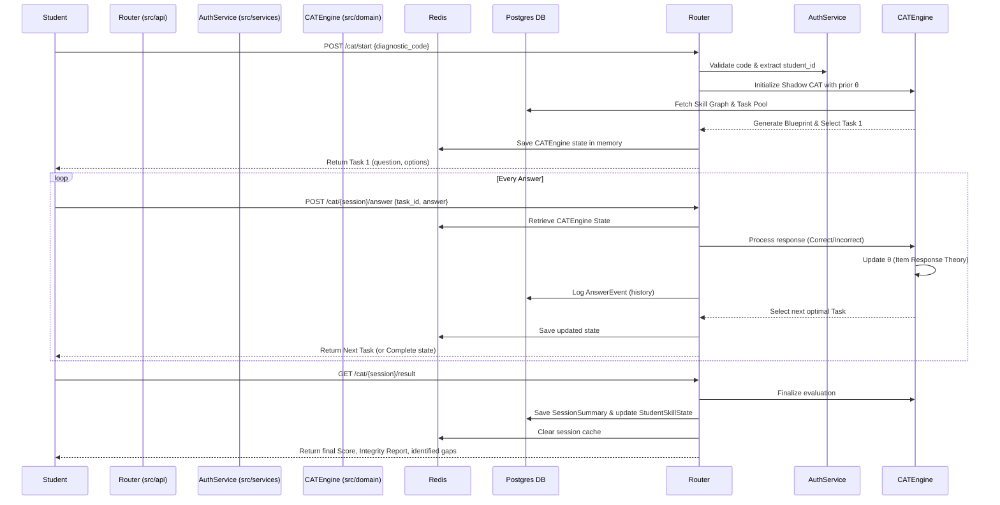
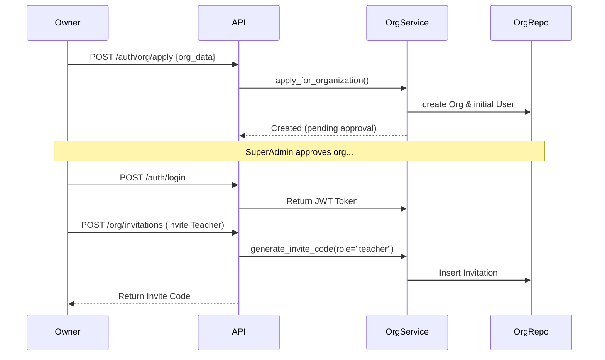

# ALGO V1 — Backend Architecture & User Flows

This document provides a comprehensive overview of the newly refactored ALGO V1 backend. The application now follows a **Clean Architecture (Service-Repository Pattern)** to separate HTTP routing, business logic, data access, and core domain engines.

---

## 1. High-Level Directory Structure

```text
src/
├── api/             # Presentation Layer: FastAPI routers & HTTP schemas
│   └── v1/          # Versioned REST endpoints (auth, cat, exam, analytics)
├── core/            # Core Infrastructure & Configuration
│   ├── config.py    # Environment variables (Pydantic BaseSettings)
│   ├── database.py  # SQLAlchemy engine, session factory, connection pooling
│   ├── security.py  # JWT encoding/decoding, password hashing
│   └── exceptions.py# Custom domain errors (NotFoundError, ValidationError)
├── domain/          # Core Business Engines (The "Brains" of the system)
│   ├── diagnostic/  # Shadow CAT Engine & IRT calibration
│   ├── exam_builder/# LLM Text generation & Sympy Distractor Engine
│   ├── graph/       # Knowledge Graph topological sorting & updates
│   ├── analytics/   # Statistical reporting and gap analysis
│   └── pipeline/    # OCR & Data Digitization pipeline
├── models/          # 100% ORM Models (SQLAlchemy Declaratives)
│   ├── auth.py      # Users, Organizations, Students, Groups
│   ├── knowledge.py # KnowledgeHierarchy, SkillPrerequisites
│   ├── tasks.py     # TaskMaster, TaskTemplateDB
│   └── ...          # analytics, textbooks, graph, etc.
├── repositories/    # Data Access Layer (SQL queries ONLY)
│   ├── base.py      # Generic BaseRepository for CRUD primitives
│   ├── user_repo.py # User and OrgMember queries
│   └── ...          # Repos for tasks, student_skills, sessions, etc.
└── services/        # Application Logic Layer (Transactions & Rules)
    ├── auth_service # Login, Sign up, Token refresh
    ├── org_service  # Org creation, invitations, approvals
    └── ...          # Services handling business logic via Repositories
```

---

## 2. The Data Flow (How an API Request is Handled)

The backend enforces a strict unidirectional data flow to decouple HTTP frameworks from pure business logic:

1. **Router (`src/api/v1/...`)**:
   - Parses the incoming HTTP Request into a Pydantic `BaseModel`.
   - Injects the Current User (via Core Dependencies) and the Database Session.
   - Instantiates the specific **Service**.
   - *Rule: No raw DB queries or complex logic allowed here.*

2. **Service (`src/services/...`)**:
   - Receives Pydantic objects or primitive data.
   - Instantiates required **Repositories**.
   - Executes business rules (e.g., "Check if user has permission", "Calculate scores").
   - Controls the database transaction (`db.commit()` or `db.rollback()`).
   - Raises custom `AlgoException` on failure.

3. **Repository (`src/repositories/...`)**:
   - Contains pure SQLAlchemy ORM queries (`session.query(Model).filter(...)`).
   - Translates rows into Python ORM objects.
   - *Rule: Never commits transactions (to allow services to bundle multiple queries).*

---

## 3. Key Modules & Entities

### A. Authentication & Organization (B2B SaaS)
- **Entities**: `Organization`, `User`, `OrganizationMember`, `Student`, `Group`
- **Methods**: `AuthService.login()`, `OrgService.create_organization()`, `GroupService.add_student()`
- **Flow**: Organization Owner registers -> Approves/Invites Teachers -> Teachers create Groups -> Students attached to Groups via codes.

### B. Knowledge & Task Management
- **Entities**: `KnowledgeHierarchy` (L1-L4 skill nodes), `SkillPrerequisite`, `TaskMaster`
- **Methods**: `KnowledgeRepo.get_skill_graph()`, `TaskRepo.get_active_tasks()`
- **Flow**: Skills represent the educational standard. Tasks are strictly mapped to an atomic L4 skill. 

### C. Diagnostic & CAT (Computerized Adaptive Testing)
- **Entities**: `DiagnosticInvite`, `StudentDiagnosticResult`, `SessionSummary`
- **Engines**: `ShadowCATEngine` (Item Response Theory), `IntegrityService`
- **Flow**: 
  1. Student enters via diagnostic code.
  2. Engine uses `IRT` to serve tasks based on previous answer accuracy (Bayesian updates for user capability `θ`).
  3. `AnswerEvent` is logged per question.
  4. At the end, diagnostic calculates `θ`, Standard Error (SE), and identifies missing prerequisites (Root Gaps).

### D. Analytics & Graph
- **Entities**: `AnswerEvent`, `StudentSkillState`, `SkillCorrelation`
- **Methods**: `StudentProgressService.get_skill_map()`, `GraphUpdater.run_batch_analysis()`
- **Flow**: Student answers → Analytics aggregates performance by skill → Graph Engine occasionally runs batch correlation to discover missing prerequisites automatically.

---

## 4. User Flow Diagrams

### Persona 1: Student taking a Diagnostic Test (CAT)



### Persona 2: Organization Owner (Admin Flow)



### Server Initialization Sequence (`src/main.py`)

1. Load `src.core.config.Settings` (DB URI, Secrets).
2. Start connection pool via `src.core.database`.
3. Load `src.api.v1.router` which internally mounts endpoints from auth, cat, textbook, analytics.
4. Apply global Middlewares (CORS, Rate Limiting, Exception Handling).
5. Listen for requests.
